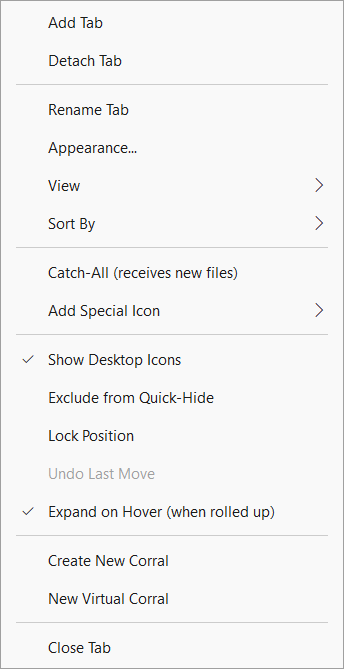
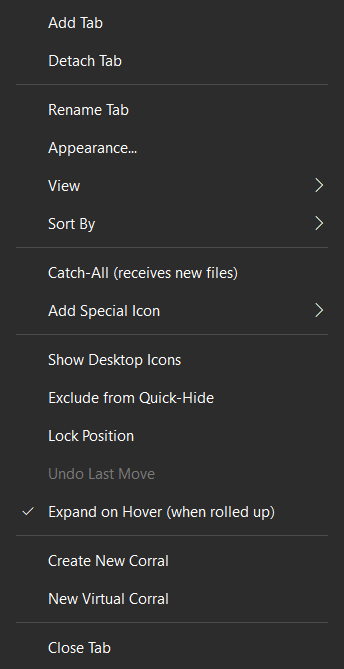
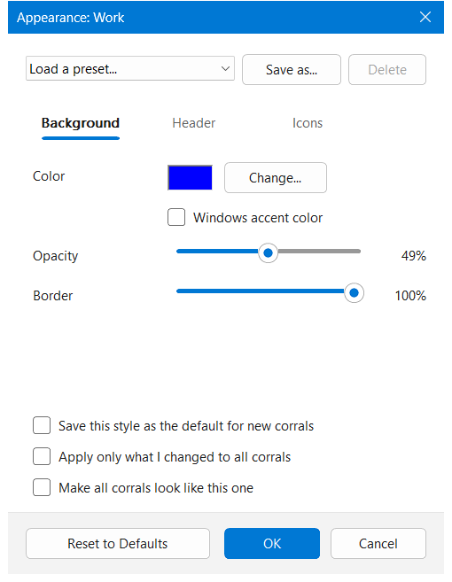
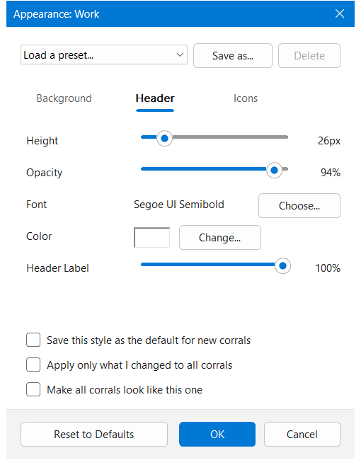
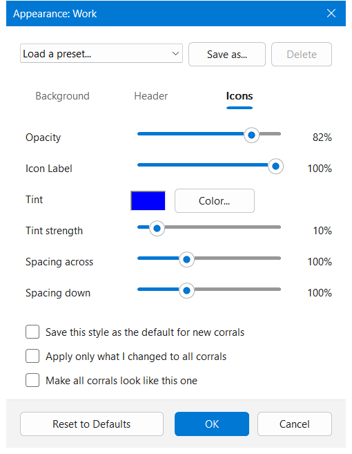
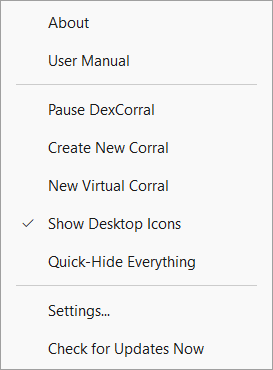
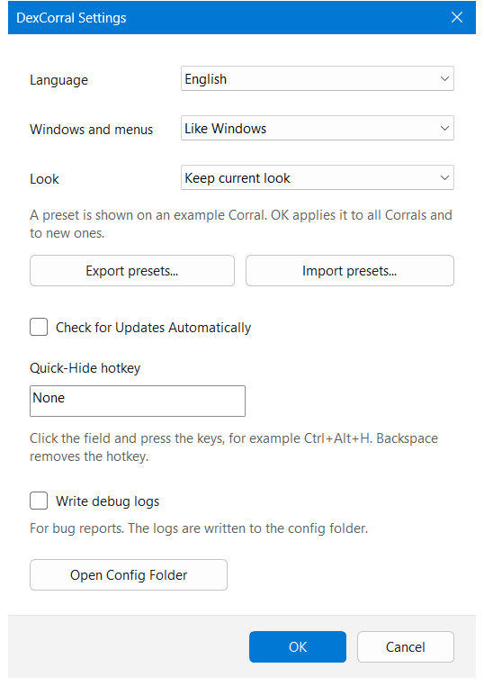
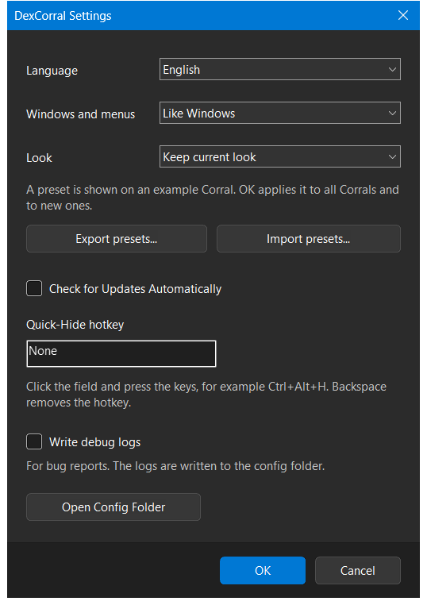

# DexCorral User Manual

DexCorral organizes your Windows desktop icons into shaded, customizable areas called **Corrals**. Icons stay real desktop icons: DexCorral integrates with Explorer through a shell extension, so drag-and-drop, context menus, and file operations work as before.

## Installation

DexCorral requires **Windows 11** (build 22000 or newer). Windows 10 is end of life and is neither tested nor supported; both the installer and `DexCorral.exe --register` refuse to run on it.

DexCorral cannot be installed on a PC that has **Stardock Fences** installed. Both programs take over the desktop icon view; see [Stardock Fences](#stardock-fences) for what happens and what to do.

### Installer (recommended)

1. Download `DexCorral_<version>_Setup.exe` from the [Releases](https://github.com/guHe330/DexCorral/releases) page.
2. Run it and choose how to install (see [Install for all users, or just me](#install-for-all-users-or-just-me) below). (SmartScreen may warn; see [Troubleshooting](#troubleshooting).)
3. The installer registers the shell extension and starts DexCorral inside the running Explorer, with no Explorer restart and no logout needed. A default Corral appears on your desktop immediately.

DexCorral loads automatically at every login. Its shell extension is loaded by Explorer on startup, so there is nothing to configure.

### Install for all users, or just me

Setup's first page asks which one you want. Both give you the same DexCorral.

- **Install for all users**: goes to `C:\Program Files\DexCorral` and needs Administrator rights, so Windows shows a UAC prompt. Every account on the PC gets DexCorral. Choose this on a shared or family PC, and if you are not sure.
- **Install for me only**: goes to `%LOCALAPPDATA%\Programs\DexCorral` and needs no Administrator rights, which makes it the option on a work PC where you do not have admin. Only your account gets DexCorral.

The two cannot be installed side by side. Setup checks for the other kind before it writes anything and offers to resolve it. The reasons, and how the two differ inside, are in the [Technical Notes](TECHNICAL_NOTES.md#install-modes).

### Portable package

1. Download `Portable_DexCorral_<version>.zip` and extract it to any folder.
2. Open a command prompt in that folder and run the one-time registration:
   - Just for you: `DexCorral.exe --register --scope=user`, no Administrator rights needed.
   - For all users: `DexCorral.exe --register --scope=machine`, from a command prompt opened **as Administrator**.

   Without `--scope`, DexCorral picks machine scope if the folder is under `Program Files` and user scope otherwise. On an unsupported Windows version this stops with a message instead of registering. Adding `--force` registers anyway, unsupported and untested.
3. Run `DexCorral.exe --startup` to start DexCorral in the current session, or restart Explorer / log out and back in.

Run `DexCorral.exe` with no arguments for the full list of options.

### Uninstalling

Uninstall from **Settings > Apps > Installed apps**, or via the Start Menu group's **Uninstall DexCorral** entry. The uninstaller asks whether to **keep your configuration** (corral layouts and appearance settings). Choose *Yes* if you plan to reinstall later. It then unregisters the shell extension and restarts Explorer to fully unload.

The uninstaller removes only what its own install mode created, including every registry entry ([the full list](TECHNICAL_NOTES.md#what-dexcorral-writes-outside-its-own-folder)). Other accounts' settings in their `%APPDATA%\DexCorral` are left alone.

After uninstalling, icons that were inside Corrals reappear as normal desktop icons; you may want to rearrange them (right-click desktop > **Sort by > Name**).

Portable package: before you delete its folder, run `DexCorral.exe --unregister` with the same `--scope` you registered with (as Administrator for `--scope=machine`). More on leftovers in the [Technical Notes](TECHNICAL_NOTES.md#removing-a-portable-package).

## Core Concepts

### Corrals
A Corral is a shaded, semi-transparent window holding a group of icons. Icons assigned to it are hidden from the regular desktop and drawn inside the Corral instead.

### Tabs
Each Corral can hold multiple **tabs**, each with its own title, icon list, background color, view mode, and header font: several groups (e.g. "Work", "Games", "Downloads") in one place on the desktop.

**Reordering tabs:** hover a tab to reveal a grip handle ("⠿") on its left edge, then drag it left or right.

**Moving icons between tabs:** drag the icons onto the tab you want them in, in the same Corral or in another one, or right-click an icon and pick the tab from **Move to Tab**. When you drag something in from the desktop or an Explorer window, resting on a tab for half a second brings that tab forward, and dropping straight onto a tab works too.

### Catch-All
One tab can be the **Catch-All**: new files and shortcuts landing on the desktop are captured into it automatically.

### Virtual Corrals
A virtual tab mirrors any folder on your PC. Point it at `Downloads` or a project directory and its files appear inside the Corral, kept in sync as the folder changes.

It is a live view of that folder, and its icons are the real files, so dragging works as it does in the folder's own Explorer window:

- **Dropping files onto it** moves or copies them into the folder, with the same cursor and the same Ctrl / Shift modifiers.
- **Dragging files out of it**, to an Explorer window, the desktop or an application, moves or copies them by Explorer's usual rules. Several selected files travel together.
- Dragged onto a **normal Corral**, a file stays where it is and gets a desktop shortcut in that Corral.

The folder can be on the network: a share (`\\nas\photos`) or a mapped network drive. DexCorral asks in the background whether the share answers, without making the other Corrals wait for it. Until the first answer is in, the Corral shows **Connecting...**. While the share does not answer, for example at sign-in before the NAS is up, the Corral shows **Folder unavailable** and asks again: after ten seconds, then after twice as long each time, up to five minutes. It also asks at once when you move the pointer over the Corral. A share that answers is left alone, so a NAS can go to sleep: DexCorral asks it only when you do something in the Corral or the folder reports a change. Because many network devices do not report changes reliably, a network folder is also read again when you move the pointer over its Corral and the last reading is more than a minute old. Reading a large folder over a slow connection can make all Corrals pause for that moment.

## Managing Corrals

### Creating
- Right-click the DexCorral **tray icon** (or the background of any Corral) and choose **Create New Corral**. DexCorral asks for its name straight away; press Esc to keep "New Corral" and name it later with **Rename Tab**.
- Choose **New Virtual Corral** instead to pick a folder and create a Corral mirroring it.
- The classic right-click menu of the desktop background offers **New DexCorral** and **New Virtual DexCorral** as well, and creates the Corral where you clicked. Hold **Shift** while you right-click the desktop to get that menu; see [Known Limitations](#known-limitations) for why.

### Moving and Resizing
- Drag the **title bar** to move a Corral.
- Moved or resized one by accident? Right-click any Corral and choose **Undo Last Move**. The Corral goes back to where it was, and so do the desktop icons it pushed out of the way; an icon you have moved by hand since stays where you put it. Choose it again to go further back, up to ten steps through the last moves and resizes of all Corrals. The steps are forgotten when you sign out, pause DexCorral or change the set of monitors.
- Drag any **edge or corner** to resize. While moving or resizing, Corrals snap to screen edges and align to other Corrals on the same monitor.
- Corrals are immune to **Win+D / Show Desktop**: they stay visible with your desktop.

### Lock Position
Right-click a Corral and choose **Lock Position** to freeze it where it is. A locked Corral cannot be moved or resized with the mouse, and a small padlock appears in its title bar. Everything else keeps working: tabs still switch, double-clicking the title bar still rolls it up, and positions are still restored per monitor and resolution. Choose **Lock Position** again to unlock.

Lock any Corral that sits where you drop files all day. An accidental drag moves the Corral and also pushes the desktop icons underneath it out of the way. **Undo Last Move** (see [Moving and Resizing](#moving-and-resizing)) takes that back, but only until you sign out.

### Roll-Up
Double-click the title bar to **roll up** a Corral so only the title bar remains visible. Double-click again to expand it.

A rolled-up Corral also opens by itself while the mouse rests on it, and closes again when the mouse leaves. If one sits where your mouse often passes and keeps popping open, right-click it and uncheck **Expand on Hover**; it then only opens on a double-click.

### Multi-Monitor
DexCorral remembers **one arrangement for each set of connected monitors** and their resolutions.

- When a monitor is disconnected, its Corrals move to the primary monitor. They keep their size and take the same relative place there, beside the Corrals that are already on it.
- You can rearrange them while they wait. That arrangement is used again the next time the same monitor is missing.
- When the monitor comes back, every Corral returns to where it was with all monitors connected.
- A Corral gets a new home monitor only when you drag it there while its own monitor is connected.
- A change of resolution works the same way: the first time, Corrals keep their size and relative place; going back to the earlier resolution restores the arrangement you had there.

### Customizing
Right-click a Corral's title bar or background:

 

- **Add Tab**: add a new tab to this Corral and name it.
- **Detach Tab**: move the current tab out into its own Corral window (shown when the Corral has more than one tab).
- **Rename Tab**: change the current tab's title.
- **Appearance...**: open the appearance dialog (see below).
- **Change Folder...**: for virtual tabs, point the tab at a different folder.
- **View**: switch between **Small / Medium / Large Icons** and **Details** (a list with name, type, size, modified date, and cloud sync status for OneDrive files).
- **Sort By**: on a normal tab, sorts the icons once by **Name** or **Type**; you can still drag them into any order afterwards, and new icons are added at the end. On a virtual tab it sets the standing sort column and direction, in every view.
- **Catch-All (receives new files)**: make this tab the catch-all for new desktop items.
- **Add Special Icon**: add special shell items such as the Recycle Bin to the Corral.
- **Show Desktop Icons**: toggle visibility of all native desktop icons.
- **Lock Position**: freeze this Corral so it cannot be moved or resized by mouse (see above).
- **Expand on Hover**: whether this Corral, when rolled up, opens under a resting mouse (see [Roll-Up](#roll-up)).
- **Create New Corral / New Virtual Corral**: same as the tray menu.
- **Close Tab / Delete Corral**: remove the current tab, or the whole Corral if it's the last tab. Contained icons return to the desktop.

### Appearance Dialog
**Appearance...** changes the look of a Corral, with a live preview on the Corral while you work. The settings are spread over three pages, chosen at the top:

  

- **Background**: the colour and opacity of the Corral fill and the opacity of the border. Tick **Windows accent color** to let the tab take the accent colour you chose in Windows instead; it then changes along with Windows, keeps the transparency you set, and its header text turns black or white for contrast. Untick it and the colour you had before is back. The border's resize grip stays visible however far down you take its opacity.
- **Header**: height and opacity of the title bar, and the font, colour and opacity of its text (the font settings are per tab).
- **Icons**: opacity of the icons and of their labels, tint colour and tint strength, and the spacing across and down (50–200%).

The row above the pages works with **presets**, complete looks under a name:

- The list holds the looks DexCorral ships and, after them, your own. Choosing one loads it into the dialog and shows it on the Corral. **OK** then gives it to every tab of this Corral; **Cancel** brings back what was there.
- **Save as...** stores what the dialog shows right now as a preset of your own. A name that already exists replaces that preset, after asking. You can keep up to 50.
- **Delete** removes the own preset that is selected. The shipped looks cannot be deleted.

Saving and deleting a preset take effect at once and are not undone by **Cancel**.

Three checkboxes at the bottom decide where the style goes when you press OK:

- **Save this style as the default for new corrals**: Corrals you create from now on start with this look.
- **Apply only what I changed to all corrals**: the settings you touched in this session, and only those, are copied to every Corral. Change just the border opacity and every Corral gets that border, keeping its own colours and fonts.
- **Make all corrals look like this one**: every setting in the dialog is copied to every Corral.

**Reset to Defaults** sets every control back to the look a new Corral would get. It previews live like any other change, and Cancel undoes it.

#### Header opacity and tabs
Header opacity fades the title bar and tab strip independently of the Corral fill.

- Inactive tabs take their opacity from the header setting and are always dimmer than the active tab, so there is no second slider.
- The slider stops short of fully transparent, because the header is the Corral's grab handle. Rolled-up Corrals are kept a little more visible than the setting; unrolling restores it exactly.
- Hovering a Corral fades its header, border, icons and text up to full strength, and back when you leave.
- DexCorral follows the Windows setting **Settings > Accessibility > Visual effects > Animation effects**. With it off, these fades, the unrolling of a rolled-up Corral and the Quick-Hide fade all switch instantly instead of animating.

#### Text opacity
The tab title and the icon labels fade on their own sliders, so text can be dialled back without touching what is behind it, or turned off entirely for a Corral that is just icons.

- **Header label** fades the active tab's title. It is a per-tab setting, like the font face and color, even though the slider sits with the per-Corral ones.
- **Icon label** fades every icon caption in the Corral.
- Both go all the way to invisible. Nothing is lost: the header still drags, rolls up and right-clicks with no title on it, and icons stay visible and clickable with no captions.
- Both fade in on hover along with the icons, border and header, on the same timing. Text set to 0% is therefore not gone: it appears when you move the mouse over the Corral and fades back out when you leave.

## Working with Icons

### Adding
- Drag any icon from the desktop and drop it onto a Corral.
- Drag a file or folder from an Explorer window onto a Corral: DexCorral puts a shortcut to it on the desktop and adds that shortcut to the Corral. The original stays where it is.
- If the cursor shows the no-drop sign, the Corral cannot take what you are dragging.
- New desktop items land automatically in the Catch-All tab, if one is set.

### Using
- **Double-click** an icon to open it.
- **Drop a file onto an icon** inside a Corral to invoke its target, e.g. drop a document onto an application's icon to open it with that app.
- **Double-click an icon's label** to rename it in place.
- **Select several icons** with Ctrl+click, Shift+click, Ctrl+A or by dragging a rectangle over them. Dragging one of the selected icons carries all of them: to another Corral, back out to the desktop, or to a new place in the same Corral.
- **Drag an icon into another application or an Explorer window** and it behaves as if dragged from the desktop: a terminal gets its path, an editor opens it. Moving it into another folder takes the file off the desktop, and so out of the Corral.
- **Scroll** with the mouse wheel or trackpad when a tab holds more icons than fit; a slim scrollbar appears on hover.

### Keyboard
Click a Corral to give it the keyboard. It then behaves like an Explorer window:

| Keys | Action |
|---|---|
| Arrow keys, Home, End | Move the selection; with Shift, extend it |
| PageUp, PageDown | Scroll one screenful |
| Ctrl+Tab, Ctrl+Shift+Tab (or Ctrl+PgDn, Ctrl+PgUp) | Next / previous tab |
| Typing a name | Jump to the icon that starts with it |
| Enter, Alt+Enter | Open, Properties |
| F2, Delete, Ctrl+C / X / V | Rename, delete, copy / cut / paste |
| Ctrl+A, Esc | Select all, clear the selection |
| F5 | Reload |
| Menu key | Context menu |
| Backspace | Up one folder (virtual tabs) |

### Right-Click Menu
Right-clicking an icon shows the standard Windows context menu (Open, Cut, Copy, Delete, Properties, ...) plus two DexCorral entries: **Move to Tab**, when the Corral has other tabs, and **Remove from Corral**, which returns the icon to the regular desktop without deleting anything. Both act on every selected icon if the one you clicked is part of a selection. Virtual tabs show neither: their icons are the files of a folder.

## Quick-Hide

Double-click an empty spot on the desktop to hide everything at once: all native desktop icons and all corrals (they fade out). Double-click the desktop again to bring everything back exactly as it was.

- Corrals can opt out: right-click a corral and check **Exclude from Quick-Hide** to keep it visible while everything else hides.
- Double-clicking the **tray icon** does the same, and so does the tray menu's **Quick-Hide Everything** entry.
- Quick-hide is temporary: restarting DexCorral always restores your normal desktop.
- For a keyboard shortcut, open **Settings** in the tray menu, click the **Quick-Hide hotkey** field and press the keys, for example Ctrl+Alt+H. Backspace in the field removes it. There is none by default.
  - The combination needs Ctrl or Alt (Shift can be added) plus one letter, digit or function key. It applies as soon as you click OK.
  - Ctrl+Alt is the same as AltGr, so avoid a letter you type with AltGr on your keyboard.
  - If the combination is already taken by Windows or another program, DexCorral says so and runs without a hotkey.
  - A combination with the Win key cannot be entered in the field; see the [Technical Notes](TECHNICAL_NOTES.md#a-quick-hide-hotkey-with-the-win-key).

## Tray Icon

Double-clicking the tray icon toggles Quick-Hide. Its right-click menu offers:



- **About**: the version, the license in one sentence, and buttons that open the website, the GitHub project and the full license text.
- **User Manual**: opens this manual on GitHub in your browser.
- **Pause DexCorral**: hides every Corral and shows all your icons as ordinary desktop icons, without restarting Explorer. Icons that live in a Corral appear where their Corral was. Choose it again to bring everything back as it was. While paused the menu is reduced to the entries that still apply, the desktop right-click menu does not offer "New DexCorral", and Quick-Hide does nothing. The pause is kept when you sign out or restart.
- **Create New Corral** / **New Virtual Corral**.
- **Show Desktop Icons**: toggle all native desktop icons.
- **Quick-Hide Everything**: hide/show icons and corrals at once (same as double-clicking the desktop). If you have set a hotkey for it (see [Quick-Hide](#quick-hide)), the keys are shown on this line.
- **Settings...**: opens the settings window, see below.
- **Check for Updates Now**: asks GitHub once, right now, whether a newer version exists, without switching the automatic check on.

### Settings

The settings window holds the options that apply to DexCorral as a whole. Changes take effect when you click **OK**. It also opens while DexCorral is paused.

 

- **Language**: switch the interface between English and German, without a restart. The installer asks once at install time; this overrides that, and for the portable package it is the only place the language is set.
- **Windows and menus**: whether DexCorral's dialogs and menus are light or dark. **Like Windows** follows the app mode set in Windows; **Light** and **Dark** override it.
- **Look**: a list of ready-made looks: **Automatic (Windows accent color)**, **Classic Blue** (the look DexCorral starts with), **Light Glass**, **Dark Glass**, **Graphite** and **Compact**. Choosing one shows it on an example Corral next to the settings window; the example cannot be clicked and disappears with the window. **OK** puts the look on every Corral and every tab and uses it for new Corrals; this replaces looks you tuned by hand in the Appearance dialog and cannot be undone. **Keep current look** and **Cancel** change nothing. Presets you saved yourself in the Appearance dialog are in the list too.
- **Export presets...** and **Import presets...**: write your own presets to a file and read such a file, to carry looks to another PC or to share them. Importing replaces an own preset of the same name and takes effect at once.
- **Check for Updates Automatically**: off by default. When on, DexCorral asks the GitHub Releases API once every 24 hours whether a newer version exists and shows a tray balloon if so. It never downloads or installs anything. See [Privacy](PRIVACY.md#the-update-check) for exactly what the request sends.
- **Quick-Hide hotkey**: see [Quick-Hide](#quick-hide).
- **Write debug logs**: off by default. Switch it on before reproducing a problem you want to report. Logging starts at once; to capture DexCorral's start as well, leave it on and sign out and back in. A debug log that passes 2 MB is renamed to `<name>.log.old` and started again, so at most two files of that size exist per log.
- **Open Config Folder**: opens `%APPDATA%\DexCorral` in Explorer, where `config.json`, its backup and any debug logs live.

## When DexCorral pauses itself

DexCorral runs inside Windows Explorer, so a fault in it can take the desktop down with it. Windows then restarts Explorer, DexCorral loads again, and without a brake that repeats. The brake is the **crash guard**: if Explorer crashes **twice within two minutes** while DexCorral is starting, DexCorral stops trying and goes into **standby**.

Standby is also what DexCorral does when [Stardock Fences](#stardock-fences) is installed. A dialog tells you when either happens. In standby:

- All your icons are ordinary desktop icons again. No Corrals are shown.
- Your layout is safe. `config.json` is not changed, and everything comes back as it was.
- The tray icon stays, with the tooltip "DexCorral is paused". Its menu shows why, and keeps About, User Manual, Settings and the update check.
- The desktop right-click menu does not offer "New DexCorral".
- It stays that way across restarts. DexCorral does not quietly try again at the next login.

To leave a crash-guard standby, right-click the tray icon and choose **Resume DexCorral**. The Corrals come back at once, without signing out. Installing a different DexCorral version also ends it, since a new build deserves a fresh attempt.

Every decision the guard makes is written to `guard.log` in `%APPDATA%\DexCorral`, whether or not debug logging is on. If DexCorral paused itself and you do not know why, attach that file and `config.json` to a bug report. What counts as a crash is described in the [Technical Notes](TECHNICAL_NOTES.md#the-crash-guard).

## Desktop Integration

Because DexCorral hooks Explorer's desktop directly:

- Icons inside Corrals are invisible to desktop hit-testing, rubber-band selection, and keyboard navigation, so you can't accidentally select or disturb them.
- Desktop **Sort by** and auto-arrange never move Corral-owned icons, and visible icons are compacted so sorting leaves no gaps where hidden icons used to be.
- Corral-owned icons are immune to repositioning by Explorer or third-party tools: only DexCorral moves them.

## Configuration

All settings (corral layouts, tabs, colors, fonts, assigned files) are stored in a single JSON file:

```
%APPDATA%\DexCorral\config.json
```

The format is forward- and backward-compatible: fields missing from an older config simply get default values. The file is written automatically; if you edit it by hand, do so while DexCorral is not running.

Two more files can appear next to it:

- `config.bak` is a copy of the last `config.json` that loaded without errors, refreshed each time DexCorral starts.
- `config.corrupt.json` is written when `config.json` cannot be read, for example after a hand edit with a stray comma. DexCorral then loads `config.bak` instead, keeps your unreadable file under this name so you can repair it, and shows a tray notification saying so. With no usable backup it starts with a fresh layout.

Deleting `config.json` still means "start over": the backup is not restored in that case.

Outside that folder DexCorral writes only a few registry entries: to register the shell extension, to start at login, and for settings that must be readable before the config file is. The uninstaller removes them all. The [Technical Notes](TECHNICAL_NOTES.md#what-dexcorral-writes-outside-its-own-folder) list every one.

## Stardock Fences

DexCorral and Stardock Fences cannot share a desktop. Each one takes over the desktop icon view, and the two do not know about each other: while Fences is running, the icons DexCorral hides become visible again and are drawn twice.

So DexCorral declines to run next to it:

- **Setup** and `DexCorral.exe --register` stop with a message, before installing anything, if Stardock Fences is installed on the PC.
- **A DexCorral that is already installed pauses itself.** If Stardock Fences is installed, or already loaded in Explorer, when DexCorral starts, DexCorral goes into [standby](#when-dexcorral-pauses-itself): no Corrals, all icons on the desktop, your layout saved and untouched. A dialog explains it the first time, a tray notification reminds you after that, and **Why is DexCorral paused?** in the tray menu shows the explanation again. There is no Resume for this: DexCorral starts normally at the first sign-in after Fences has been uninstalled.
- **If Fences is started while DexCorral is running**, for instance right after you install it, DexCorral tells you once. It cannot step aside in a session that is already running, so until you sign out the doubled icons may appear. At the next sign-in it pauses as described above.

This applies whenever Fences is installed, also if it is switched off: DexCorral cannot tell when it will be switched on again. There is no override.

Which of the two you use is your choice. To use DexCorral, uninstall Stardock Fences first, then run Setup again. DexCorral never changes, stops or removes anything belonging to Fences. How DexCorral recognises Fences is in the [Technical Notes](TECHNICAL_NOTES.md#how-stardock-fences-is-recognised).

*Stardock and Fences are trademarks of Stardock. DexCorral is not affiliated with Stardock.*

## Known Limitations

- **Identical filenames on the user and Public desktop**: corral membership is stored as a bare filename, so DexCorral assumes the one on the user desktop. The same *display* name with different filenames (a folder `test` next to `test.txt`) is handled correctly.
- **Network folders**: whether a share answers is checked in the background before DexCorral touches it, but the folder itself is read on the thread all Corrals share. If a share stops answering in the two seconds after such a check, or while the folder is being read, Corrals can stall once until Windows gives up on it. A new network Corral is empty until the first check has answered.
- **"New DexCorral" missing from the desktop menu**: DexCorral adds its entries to the classic desktop menu. Since the customizable context menu that Microsoft introduced with [KB5127936](https://support.microsoft.com/en-us/servicing/os/windows-11/2026/10/kb5127936-windows-11-25h2-26h2-update) (October 2026, rolled out in phases; seen here after [KB5132061](https://support.microsoft.com/en-us/servicing/os/windows-11/2026/11/kb5132061-windows-11-24h2-25h2-26h2-security-update), build 26200.9974), a plain right-click on the desktop shows the new menu, which does not list DexCorral. The registry setting that used to make the classic menu the default no longer has an effect there.
  - **Hold Shift and right-click the desktop**: this opens the classic menu with both entries. Microsoft describes it on the KB5127936 page: "To see more options, hold down Shift and right-click on your desktop."
  - Or create Corrals from the tray menu or from the right-click menu of any Corral.

## Troubleshooting

- **SmartScreen / antivirus warnings**: the binaries are currently unsigned, so Windows reports the publisher as unknown. Code signing is planned. In the meantime every release publishes SHA-256 checksums and a GitHub build provenance attestation, so you can verify a download rather than taking it on trust: see the release page for both, and `gh attestation verify <file> --repo guHe330/DexCorral` to check the attestation.
- **Corrals don't appear after install**: right-click the desktop once to wake the shell, or log out and back in (the Start-with-Windows entry re-injects DexCorral at login).
- **Desktop icons misbehave**: restarting Explorer resets the hook: `Stop-Process -Name explorer -Force; Start-Process explorer.exe` in PowerShell, or via Task Manager.
- **Bug reports**: please file issues at the [GitHub issue tracker](https://github.com/guHe330/DexCorral/issues).
